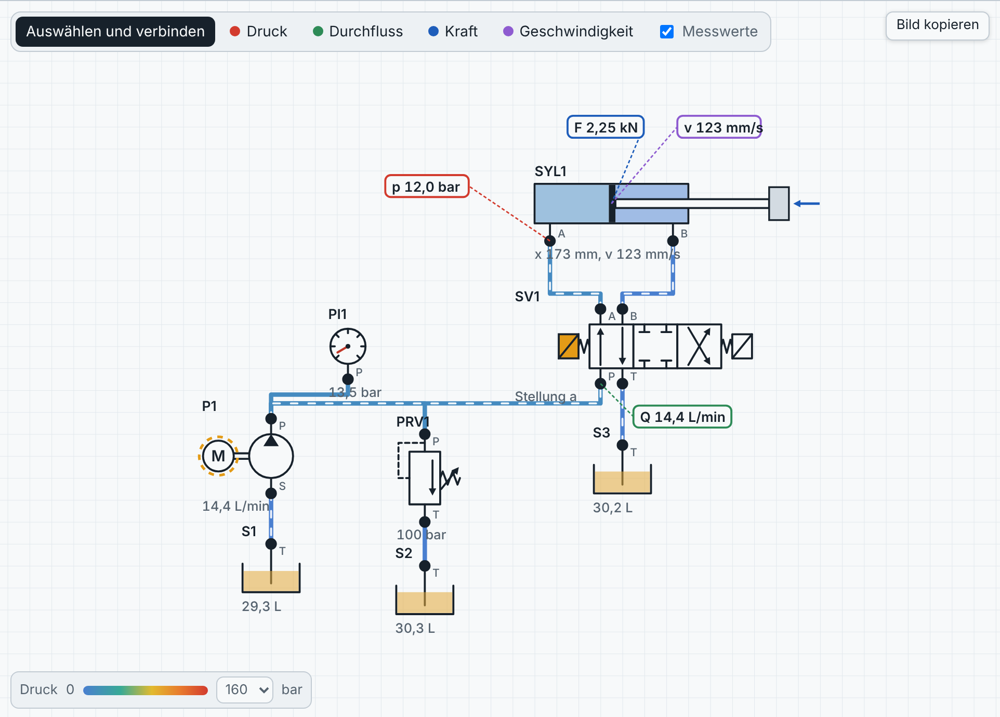
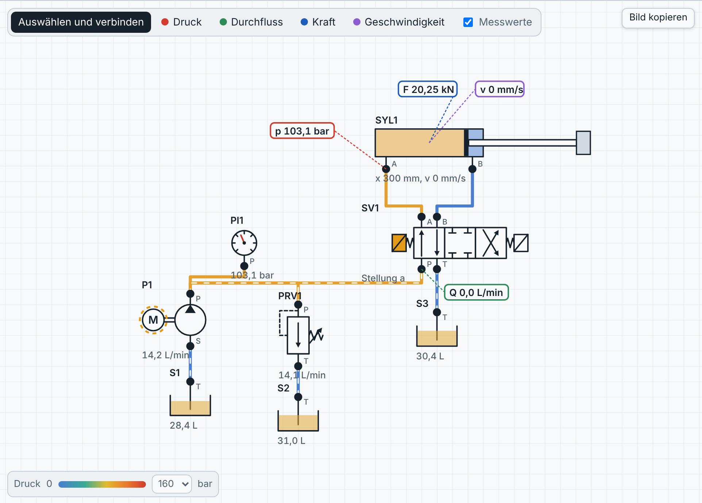
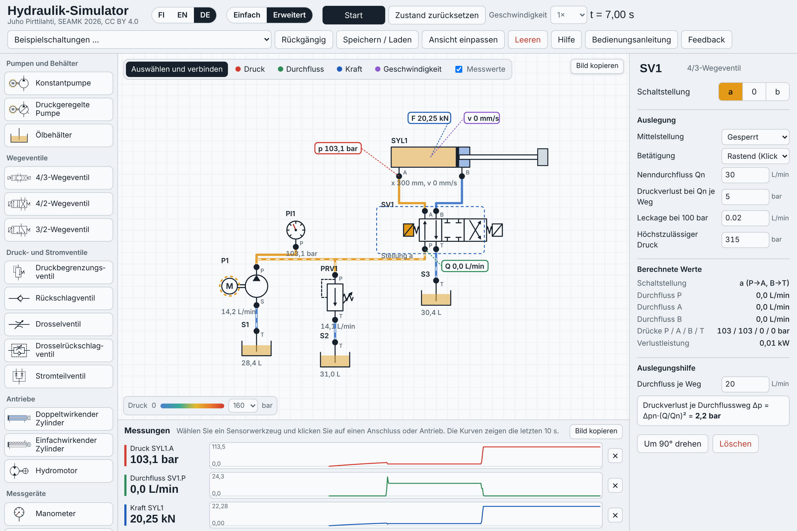

# Hydraulik-Simulator – Bedienungsanleitung

Juho Pirttilahti, Fachhochschule Seinäjoki (SEAMK), 2026 · CC BY 4.0

> Diese Datei ist die versionierte Kopie der Bedienungsanleitung. Wenn der Simulator geändert wird, aktualisieren Sie diese Anleitung im selben Pull Request.

## Was der Simulator ist

Der Hydraulik-Simulator ist eine browserbasierte Übungsumgebung, in der ein Hydraulikkreislauf aus Schaltzeichen nach Art der ISO 1219 aufgebaut wird und man sofort sieht, wie sich Druck, Volumenstrom, Kraft und Geschwindigkeit verhalten. Eine Installation ist nicht nötig, und der Schaltplan wird automatisch im Browser gespeichert.

Öffnen Sie den Simulator unter <https://jipirtti.github.io/Hydrauliikkasimulaattori/?lang=de>.

Mit dem Simulator lässt sich zum Beispiel üben:

- wie ein Druckbegrenzungsventil den Systemdruck begrenzt und wohin der Förderstrom der Pumpe fließt, wenn der Antrieb stehen bleibt
- warum ein doppeltwirkender Zylinder schneller und mit geringerer Kraft einfährt als ausfährt
- wie sich Zulauf- und Ablaufdrosselung unterscheiden und warum die Ablaufdrosselung den Druck auf der Ringseite über den Systemdruck anheben kann
- wie die Mittelstellung eines Wegeventils das Halten der Last, die Belastung der Pumpe und das Stoppen eines Motors beeinflusst
- die Auslegung von Bauteilen: Kolbendurchmesser aus der Kraft, Verdrängungsvolumen der Pumpe aus dem Förderstrom und Verdrängungsvolumen des Motors aus dem Drehmoment.

Der Simulator dient dem Verständnis der Vorgänge. Seine Ergebnisse ersetzen nicht die Auslegungsberechnung eines Systemlieferanten (siehe Grenzen des Modells).

## Einfaches und erweitertes Modell

Mit dem Umschalter **Einfach | Erweitert** in der Kopfzeile wird das Simulationsmodell auf dieselbe Weise gewechselt wie die Sprache. Der Wechsel erfolgt im laufenden Betrieb, der Schaltplan bleibt erhalten, und die Wahl wird im Browser gespeichert.

| | Einfach | Erweitert |
| --- | --- | --- |
| Zweck | Grundgleichungen lernen: Das Ergebnis entspricht direkt der Handrechnung | Verluste eines realen Systems und ihre Auswirkungen untersuchen |
| Pumpe | Keine Leckage und kein Wirkungsgrad: Q = Vg·n/1000 | Volumetrischer und hydraulisch-mechanischer Wirkungsgrad, Leckage steigt mit dem Druck |
| Druckbegrenzungsventil | Der Druck bleibt auf dem Einstellwert | Der Druck steigt mit dem Durchfluss (Kennlinie) |
| Wege-, Rückschlag- und Stromteilventile | Praktisch kein Druckverlust und keine Leckage | Druckverlust Δp = Δpn·(Q/Qn)², Leckage |
| Zylinder | Keine Reibung: p = F / A | Reibung, Haftreibung und viskose Dämpfung |
| Hydromotor | Keine Leckage und keine Reibung: n = Q / Vg, Δp = 20π·T / Vg | Leckage, Wirkungsgrad und viskose Reibung |
| Schläuche | Kein Druckverlust; Strömungsgeschwindigkeit und berechneter Druckverlust werden zum Vergleich angezeigt | Druckverlust nach Innendurchmesser und Länge, Ölvolumen des Schlauchs berücksichtigt |
| Eigenschaftenfeld | Nur Grundauslegung (z. B. Zylinder D, d, Hub, Masse, Last) | Alle Parameter |

Die Drosselung von Drosselventil und Drosselrückschlagventil wirkt in beiden Modellen gleich, weil das Drosseln ihre Aufgabe ist. Im einfachen Modell beeinflusst die Dämpfung der Antriebe nur Geschwindigkeitsänderungen: Sie dämpft Schwingungen, die Drücke und Geschwindigkeiten einer gleichförmigen Bewegung entsprechen aber den Grundgleichungen. Nach dem Beschleunigen stellt sich der Druck in etwa einer Sekunde ein.

Der Modellwechsel löscht keine Werte. Im erweiterten Modell eingestellte Verlustparameter (z. B. Reibungskraft) bleiben erhalten und werden beim Zurückwechseln in das erweiterte Modell wieder verwendet.

Das Modell lässt sich im Link voreinstellen: `?mode=simple` oder `?mode=advanced` (auf Finnisch `?malli=yksinkertainen` oder `?malli=kehittynyt`), zum Beispiel https://jipirtti.github.io/Hydrauliikkasimulaattori/?mode=simple&lang=de. Sprache und Modell lassen sich kombinieren: `?lang=de&mode=simple`.

**Bei Aufgaben** sollte immer angegeben werden, mit welchem Modell sie zu bearbeiten sind. Ein gutes Vorgehen ist, den Vorgang zuerst von Hand zu berechnen, ihn mit dem einfachen Modell zu prüfen und dann mit dem erweiterten Modell zu sehen, wie stark die Verluste das Ergebnis verändern.

## Aufbau der Ansicht

Die Ansicht ist in fünf Bereiche gegliedert. Auf einem schmalen Bildschirm, etwa einem Telefon, werden die Bereiche untereinander angeordnet, und die Palette scrollt waagerecht.

| Bereich | Lage | Was dort geschieht |
| --- | --- | --- |
| Kopfzeile | Oben | Simulation starten oder anhalten, Zustand zurücksetzen, Geschwindigkeit wählen (1×–0,1×), Beispielschaltung laden, rückgängig machen, speichern oder laden, Ansicht einpassen, Zeichenfläche leeren, Hilfe öffnen. Die Simulationszeit erscheint als t = … s. |
| Palette | Linker Rand | Bauteile nach Gruppen: Pumpen und Behälter, Wegeventile, Druck- und Stromventile, Antriebe, Messgeräte. |
| Zeichenfläche | Mitte | Hier wird der Schaltplan aufgebaut und simuliert. Oben links befindet sich die Werkzeugleiste (Auswählen und verbinden, Druck, Durchfluss, Kraft, Geschwindigkeit, Messwerte). Unten liegen die Farbskala des Drucks und die Warnungen. |
| Eigenschaftenfeld | Rechter Rand | Kennzeichen, Bedienung, Auslegungsparameter, berechnete Werte und Auslegungshilfe des gewählten Bauteils. Ist nichts gewählt, zeigt das Feld eine Zusammenfassung des Schaltplans und eine Kurzanleitung. |
| Messungen | Unten Mitte | Aktueller Messwert jedes Sensors und eine Kurve über 10 Sekunden. Ein Sensor wird mit der Schaltfläche ✕ entfernt. |

Die Zeichenfläche wird durch Ziehen auf freier Fläche verschoben und mit dem Mausrad gezoomt. Ansicht einpassen bringt den gesamten Schaltplan auf den Bildschirm.

## Schaltplan aufbauen

Ein Schaltplan entsteht in drei Schritten: Bauteile auf die Zeichenfläche, Schläuche von Anschluss zu Anschluss, Auslegungswerte einstellen.

### Bauteil hinzufügen und verschieben

1. Ziehen Sie ein Bauteil aus der Palette auf die Zeichenfläche. Alternativ klicken Sie es an; es erscheint dann in der Mitte der Ansicht.
2. Verschieben Sie ein Bauteil, indem Sie seinen Körper ziehen. Die Position rastet in einem 10-Pixel-Raster ein.
3. Drehen Sie das gewählte Bauteil mit der Taste R oder der Schaltfläche Um 90° drehen im Eigenschaftenfeld um 90°.
4. Löschen Sie das gewählte Bauteil mit der Taste Entf oder der Schaltfläche Löschen. Die daran angeschlossenen Schläuche und Sensoren werden ebenfalls entfernt.

### Mehrere Bauteile auswählen, verschieben und kopieren

- **Rahmenauswahl:** Halten Sie die Umschalttaste gedrückt und ziehen Sie auf freier Fläche einen Rahmen auf. Alle Bauteile, die der Rahmen berührt, werden ausgewählt. Ohne Umschalttaste verschiebt das Ziehen wie bisher die Ansicht.
- **Umschalt+Klick** fügt ein Bauteil der Auswahl hinzu oder entfernt es daraus.
- **Strg+A** wählt alle Bauteile aus, **Esc** hebt die Auswahl auf.
- **Gruppe verschieben:** Ziehen Sie ein beliebiges gewähltes Bauteil, dann verschieben sich alle gewählten Bauteile um denselben Betrag. Schläuche zwischen den gewählten Bauteilen werden mit ihrem geformten Verlauf mitverschoben. Schläuche zu Bauteilen außerhalb der Auswahl bleiben verbunden und dehnen sich.
- **Kopieren und Einfügen:** Strg+C kopiert die gewählten Bauteile, ihre Auslegung und die Schläuche zwischen ihnen. Strg+V fügt die Kopie 40 Pixel versetzt mit neuen Kennzeichen ein (z. B. SYL2); die eingefügten Bauteile bleiben gewählt und lassen sich sofort an ihren Platz ziehen. Schläuche, die aus der Auswahl hinausführen, werden nicht kopiert.
- **Löschen:** Entf löscht alle gewählten Bauteile.

Bei einer Auswahl mehrerer Bauteile zeigt das Eigenschaftenfeld deren Kennzeichen sowie die Schaltflächen Kopieren, Einfügen und Auswahl löschen. Die Auslegung wird weiterhin Bauteil für Bauteil bearbeitet. Rahmenauswahl und Umschalt+Klick erfordern eine Tastatur und funktionieren daher nicht auf einem Touchscreen.

### Leitungen zeichnen

1. Achten Sie darauf, dass in der Werkzeugleiste Auswählen und verbinden gewählt ist. Ist ein Sensorwerkzeug aktiv, fügt ein Klick einen Sensor hinzu, statt eine Leitung zu beginnen. Esc schaltet zurück auf das Auswahlwerkzeug.
2. Drücken Sie die Maustaste auf dem kleinen Kreis eines Anschlusses. Der Cursor wird zum Kreuz. Drücken Sie auf den Körper, beginnt sich das Bauteil zu bewegen.
3. Ziehen Sie auf einen anderen Anschluss und lassen Sie los. Eine gestrichelte Linie zeigt den Anschlusspunkt; ein Abstand von etwa 14 Pixeln zum Anschluss genügt.

Der Verlauf der Leitung wird automatisch rechtwinklig gezeichnet. Überlappen sich Leitungen oder ist der Verlauf sonst ungünstig, ändern Sie ihn durch Ziehen:

1. Drücken Sie die Maustaste auf dem Abschnitt der Leitung, den Sie verschieben möchten. Die Leitung wird gewählt und dicker dargestellt.
2. Ziehen Sie. Ein waagerechter Abschnitt bewegt sich nach oben oder unten, ein senkrechter zur Seite, und die angrenzenden Abschnitte dehnen sich mit. Die Position rastet im 10-Pixel-Raster ein.
3. Lassen Sie los. Die Enden der Leitung bleiben an den Anschlüssen, Verbindung und Simulation ändern sich also nicht.

Ziehen Sie einen Abschnitt, der bis zu einem Anschluss reicht, entsteht in der Leitung eine neue Ecke, und das Ende bleibt am Anschluss. Der bearbeitete Verlauf wird mit dem Schaltplan gespeichert. Wenn Sie ein Bauteil verschieben, folgen die Enden einer bearbeiteten Leitung den Anschlüssen, und der Verlauf bleibt rechtwinklig. Ein Doppelklick auf die Leitung oder die Schaltfläche Automatischer Verlauf im Eigenschaftenfeld stellt den automatischen Verlauf wieder her, Rückgängig nimmt das Ziehen zurück.

- **Abzweig (T-Stück):** Schließen Sie einen zweiten Schlauch an denselben Anschluss an. In die Mitte einer Leitung kann nicht angeschlossen werden. Die Schläuche eines Abzweigs gehen vom selben Anschluss aus; durch Ziehen lassen sie sich getrennt führen.
- **Verschlussstopfen:** Ein nicht verbundener Anschluss ist verschlossen. Zum Beispiel kann B eines 4/2-Wegeventils im Kreislauf eines einfachwirkenden Zylinders unverbunden bleiben.
- **Verbindungszustand:** Ein verbundener Anschluss erscheint als ausgefüllter Punkt, ein nicht verbundener als leerer Kreis.
- **Leitung löschen:** Klicken Sie auf die Leitung, sodass sie dicker wird, und drücken Sie Entf oder Verbindung löschen.
- **Rückgängig:** Strg+Z oder die Schaltfläche Rückgängig nimmt die letzte Änderung zurück. 60 Schritte werden gespeichert.

Sind die Anschlüsse schwer zu treffen, zoomen Sie mit dem Mausrad heran.

## Bauteile und Auslegung

Die Palette enthält 15 Bauteile. Ist ein Bauteil gewählt, werden seine Parameter im Abschnitt Auslegung des Eigenschaftenfelds geändert. Die berechneten Werte werden während der Simulation aktualisiert, und die Auslegungshilfe berechnet umgekehrt die erforderliche Größe.

| Bauteil | Anschlüsse | Wichtigste Auslegungsparameter | Auslegungshilfe |
| --- | --- | --- | --- |
| Konstantpumpe | P, S (Saugseite) | Vg (cm³/U), n (1/min), Nenndruck, ηv, ηhm | Vg aus dem gewünschten Förderstrom |
| Druckgeregelte Pumpe | P, S | Wie oben + Reglereinstellung | Vg aus dem gewünschten Förderstrom |
| Ölbehälter | T | Volumen, Anfangsölvolumen | – |
| 4/3-Wegeventil | P, T, A, B | Mittelstellung (gesperrt, Umlaufstellung, offen, Schwimmstellung), Betätigung (rastend oder Federrückstellung), Qn und Δp je Weg, Leckage | Druckverlust bei gegebenem Durchfluss |
| 4/2-Wegeventil | P, T, A, B | Betätigung, Qn, Δp, Leckage. Ruhestellung b: P→B, A→T | Druckverlust bei gegebenem Durchfluss |
| 3/2-Wegeventil | P, A, T | Betätigung, Qn, Δp, Leckage. Stellung a: P→A, T gesperrt. Ruhestellung b: A→T, P gesperrt | Druckverlust bei gegebenem Durchfluss |
| Druckbegrenzungsventil | P, T | Einstelldruck, Qn, Druckanstieg bei Qn | – |
| Rückschlagventil | A → B | Öffnungsdruck, Qn, Δp bei Qn | – |
| Drosselventil | A, B | Öffnung %, Qn ganz offen, Δp bei Qn | Öffnung % aus gewünschtem Durchfluss und Druckdifferenz |
| Drosselrückschlagventil | A, B | Drosselung A→B, freier Durchfluss B→A über das Rückschlagventil | – |
| Stromteilventil | P (Eingang), A, B (Ausgänge) | Teilungsverhältnis, Anteil an Ausgang A (%), Qn, Δp bei Qn. Teilt den Eingangsstrom unabhängig von den Lastdrücken in festem Verhältnis auf die Ausgänge auf. Ist ein Ausgang blockiert, bleibt auch der andere stehen. In Rücklaufrichtung führt das Ventil die Ströme im selben Verhältnis zusammen. | – |
| Doppeltwirkender Zylinder | A (Kolbenseite), B (Stangenseite) | D, d, Hub, Masse, Last und Lastart, Einbaulage, Reibung, Dämpfung, Anfangsstellung | D aus Kraft und Druck (schlägt eine Normgröße D/d vor), Q aus der gewünschten Geschwindigkeit |
| Einfachwirkender Zylinder | A | D, Hub, Masse, Last, Federvorspannung und Federsteifigkeit, Einbaulage | D aus Kraft und Druck |
| Hydromotor | A, B | Vg, Lastmoment, Trägheitsmoment, Reibung, ηhm, Leckage | Vg aus Drehmoment und Druckdifferenz, Q aus der Drehzahl |
| Manometer und Durchflussmesser | P / A, B | Messbereich | – |

Alle druckführenden Bauteile haben einen Höchstzulässigen Druck. Überschreitet der Druck im Kreislauf diesen Wert, erscheint auf der Zeichenfläche eine Warnung.

**Die Lastart eines Zylinders** sollte bewusst gewählt werden:

- *Wirkt der Bewegung entgegen* wirkt wie Reibung. Sie bremst sowohl das Aus- als auch das Einfahren.
- *Konstante Kraft* drückt die Stange nach innen, wenn F positiv ist (ein negatives F zieht nach außen). Sie unterstützt das Einfahren und kann eine ziehende Last und Kavitation verursachen.
- *Senkrecht, fährt nach oben aus* fügt die Gewichtskraft m·g hinzu, die dem Ausfahren entgegenwirkt und die Last absenkt, wenn die Seite A zum Behälter geöffnet wird.
- *Senkrecht, fährt nach unten aus* (Kolbenstange nach unten, hängende Last) kehrt die Richtung der Schwerkraft um: m·g unterstützt das Ausfahren und wirkt dem Einfahren entgegen, sodass das Einfahren auf der Ringseite einen Druck von m·g / (A − a) erfordert. Ohne Bremsung läuft die Last beim Ausfahren schneller vor, als die Pumpe fördert, und die Seite A kavitiert.

Formeln der Auslegungshilfe:

$$D = \sqrt{\frac{4F}{\pi p}} \qquad V_g = \frac{Q \cdot 1000}{n \cdot \eta_v} \qquad V_g = \frac{20\pi T}{\Delta p \cdot \eta_{hm}}$$

Einheiten: D (m), F (N), p (Pa); Vg (cm³/U), Q (L/min), n (1/min); T (Nm), Δp (bar).

## Schlauchauslegung

Jeder Schlauch hat einen Innendurchmesser und eine Länge. Klicken Sie auf einen Schlauch, dann erscheinen im Eigenschaftenfeld seine Auslegung, die berechneten Werte und die Auslegungshilfe.

**Auslegungsparameter**

| Parameter | Standard | Erläuterung |
| --- | --- | --- |
| Innendurchmesser di | 12,5 mm | In das Feld kann jeder Wert von 2–100 mm eingegeben werden. Das Menü enthält die Norm-Innendurchmesser für Schläuche 5; 6,3; 8; 10; 12,5; 16; 19; 25; 31,5; 38 und 51 mm. |
| Länge L | 1 m | 0,1–50 m |
| Leitungsart | Automatisch | Automatische Erkennung: Ein Schlauch zum Anschluss S einer Pumpe ist eine Saugleitung, ein Schlauch zu einem Behälter oder zum Anschluss T eines Ventils eine Rücklaufleitung, die übrigen sind Druckleitungen. Die Art kann auch von Hand gewählt werden; zum Beispiel ist in einer Eilgangschaltung der Schlauch vom Anschluss T zur Leitung A eine Druckleitung. |

**Berechnete Werte**

- Druck an beiden Enden des Schlauchs und Durchfluss im Schlauch.
- Strömungsgeschwindigkeit v = Q / A mit A = π/4·di². Der Wert erscheint rot, wenn er die Empfehlung überschreitet.
- Empfohlene Geschwindigkeit nach Leitungsart, Durchfluss und Druck (Tabelle unten).
- Reynolds-Zahl Re = v·di / ν und Strömungsform: laminar (Re ≤ 2300), Übergangsbereich oder turbulent (Re ≥ 4000).
- Rohrreibungszahl λ: bei laminarer Strömung λ = 64 / Re, bei turbulenter nach Blasius λ = 0,316 · Re^−0,25.
- Druckverlust Δp = λ · (L / di) · ρ·v² / 2. Bei laminarer Strömung entspricht dies dem Gesetz von Hagen–Poiseuille Δp = 128·μ·L·Q / (π·di⁴).
- Ölvolumen V = π/4·di²·L.

Die Öldaten sind die eines Öls ISO VG 46 bei 40 °C: kinematische Viskosität ν = 46 mm²/s und Dichte ρ = 870 kg/m³ (dynamische Viskosität μ = ρ·ν). Im Übergangsbereich (Re 2300–4000) werden die Rohrreibungszahlen stetig ineinander übergeleitet, damit die Berechnung stabil bleibt. Einzelwiderstände von Verschraubungen, Bögen und Abzweigen werden nicht berechnet.

**Empfohlene Strömungsgeschwindigkeiten**

| Leitung | Bedingung | Empfehlung |
| --- | --- | --- |
| Saugleitung | – | 0,5–1,5 m/s |
| Rücklaufleitung | – | 1–3 m/s |
| Druckleitung | Q ≤ 10 L/min, p ≤ 160 bar | 1–2 m/s |
| Druckleitung | Q ≤ 10 L/min, p > 160 bar | 2–3 m/s |
| Druckleitung | Q > 10 L/min, p ≤ 160 bar | 3–5 m/s |
| Druckleitung | Q > 10 L/min, p > 160 bar | 5–7 m/s |

Quelle: SAL Hydro, Technical support – Flow velocity, <https://www.salhydro.fi/en/technical-support/flow-velocity>. Andere Quellen nennen teilweise etwas andere Grenzwerte. Parker verwendet zum Beispiel für Saugleitungen 1,2 m/s, für Rücklaufleitungen 3 m/s und für Druckleitungen 7,6 m/s.

Überschreitet die Strömungsgeschwindigkeit die Obergrenze der Empfehlung, erscheint auf der Zeichenfläche eine Warnung, die den Schlauch nennt. Die Untergrenze ist eine wirtschaftliche Grenze: Eine langsamere Strömung bedeutet einen unnötig großen und teuren Schlauch, führt aber zu keiner Warnung.

Die **Auslegungshilfe** berechnet den kleinsten Innendurchmesser bei gegebenem Durchfluss und Druck: di ≥ √(4Q / (π·v_max)), wobei v_max die Obergrenze der Empfehlung ist. Die Hilfe schlägt die nächste Normgröße vor, die die Bedingung erfüllt, und zeigt die damit erreichte Geschwindigkeit. Die Schaltfläche di = … übernehmen setzt die Größe für den Schlauch. Der vorgegebene Durchfluss ist der aktuelle Durchfluss im Schlauch oder, wenn kein Durchfluss vorliegt, der Förderstrom der Pumpen.

**Modelle:** Im erweiterten Modell werden der Druckverlust und das Ölvolumen des Schlauchs in der Berechnung berücksichtigt. Ein zu kleiner Schlauch zeigt sich also als Antriebsdruck, als Druckanstieg an der Pumpe und gegebenenfalls als langsamere Bewegung, und ein zu kleiner Saugschlauch kann Kavitation verursachen. Im einfachen Modell haben die Schläuche keinen Druckverlust. Strömungsgeschwindigkeit, Reynolds-Zahl und berechneter Druckverlust werden dennoch zum Vergleich angezeigt.

In den Beispielschaltungen sind die Schläuche nach den Empfehlungen ausgelegt. In den Beispielen 1–4 (14,5 L/min) ist die Saugleitung 19 mm und sind die übrigen Schläuche 12,5 mm. In den Beispielen 5–7 (43,5 L/min) ist die Saugleitung 31,5 mm, sind die Druckleitungen 16 mm und die Rücklaufleitungen 19 mm. Die Eilgangleitungen von Beispiel 5 sind 25 mm, weil ihr Durchfluss im Eilgang etwa 140 L/min beträgt. Die Schlauchauslegung wird mit dem Schaltplan gespeichert und beim Kopieren und Einfügen mitkopiert.

## Simulation ausführen und bedienen

Die Simulation startet beim Öffnen der Seite von selbst und rechnet in Echtzeit. Wählen Sie zuerst in der Kopfzeile das Simulationsmodell (Einfach oder Erweitert, siehe oben). Der Schaltplan lässt sich während der Simulation bearbeiten: Eine neue Verbindung wirkt sofort.

- **Start / Pause** (oder Leertaste) friert die Zeit ein. Messwerte und Kurven bleiben zur Betrachtung sichtbar.
- **Geschwindigkeit** 0,5×, 0,2× oder 0,1× verlangsamt schnelle Vorgänge, etwa die Druckspitze, wenn ein Zylinder an den Endanschlag fährt.
- **Zustand zurücksetzen** setzt die Drücke auf null, die Zylinder in ihre Anfangsstellung und die Behälter auf ihre Anfangsfüllung und löscht die Kurven. Schaltplan und Auslegung bleiben erhalten.

**Wegeventil betätigen.** Klicken Sie auf den Magneten des Ventils, also das Kästchen mit der Schräglinie am Ende des Schaltzeichens. Der linke Magnet schaltet in Stellung a (P→A, B→T), der rechte in Stellung b (P→B, A→T). Der aktive Magnet erscheint orange, und die Schaltfelder des Ventils verschieben sich so, dass das wirksame Feld an den Anschlüssen liegt. Die Stellung lässt sich auch mit den Schaltflächen a, 0 und b im Eigenschaftenfeld wählen.

- *Rastend:* Der Magnet bleibt eingeschaltet, bis Sie ihn erneut anklicken.
- *Federrückstellung:* Der Magnet ist nur eingeschaltet, solange Sie die Maustaste gedrückt halten; die Feder stellt das Ventil in die Mittelstellung bzw. beim 4/2-Wegeventil in die Ruhestellung b zurück.

**Pumpe bedienen.** Klicken Sie auf den Elektromotor M der Pumpe oder auf die Schaltfläche im Eigenschaftenfeld. Um einen laufenden Motor dreht sich eine orange gestrichelte Linie. Beim Einschalten erreicht die Pumpe ihre Drehzahl in etwa 0,1 Sekunden.

**Die Drosselöffnung** wird mit dem Schieberegler im Eigenschaftenfeld eingestellt; die Änderung zeigt sich sofort in der Geschwindigkeit.

## Messungen und Sensoren

Messinformationen gibt es auf vier Wegen: Sensoren, Messgeräte als Bauteile, Schlauchfarben und der Kurzmesswert unter dem Mauszeiger.

### Sensoren (Sensorwerkzeuge)

Wählen Sie in der Werkzeugleiste einen Sensor und klicken Sie auf das Ziel. Das Etikett des Sensors erscheint in der Zeichnung, seine Kurve im Bereich Messungen. Das Etikett lässt sich durch Ziehen verschieben.

| Sensor | Wird gesetzt an | Zeigt | Einheit |
| --- | --- | --- | --- |
| Druck (p) | einen Anschluss (auch am Schlauchende oder am nächsten Anschluss eines Bauteils) | Druck am Anschluss | bar |
| Durchfluss (Q) | einen Anschluss | Volumenstrom durch den Anschluss. Positiv = fließt in das Bauteil. | L/min |
| Kraft (F) | einen Zylinder | Hydraulische Kraft pA·A − pB·(A − a). Positiv drückt nach außen. | kN |
| Kraft (T) | einen Motor | Drehmoment | Nm |
| Geschwindigkeit (v) | einen Zylinder | Kolbengeschwindigkeit. Positiv = Ausfahren. | mm/s |
| Geschwindigkeit (n) | einen Motor | Drehzahl | 1/min |

Die Kurve zeigt einen Verlauf über 10 Sekunden und skaliert automatisch. Ober- und Untergrenze der Skala stehen am linken Rand der Kurve. Ein Sensor wird mit der Schaltfläche ✕ im Bereich Messungen entfernt.

### Weitere Messwerte

- **Die Farbe eines Schlauchs** zeigt den Druck: Blau ist niedrig, Grün und Gelb mittel, Rot nahe am Maximum der Skala. Das Maximum (100, 160, 250 oder 400 bar) lässt sich mit dem Wähler in der unteren Ecke ändern. Violett bedeutet Unterdruck.
- **Eine bewegte gestrichelte Linie** im Schlauch zeigt die Strömungsrichtung, ihre Geschwindigkeit wächst mit dem Durchfluss. Eine ruhende durchgezogene Linie = kein Durchfluss.
- Die Option **Messwerte** zeigt unter jedem Bauteil einen kurzen Messwert, etwa Position und Geschwindigkeit eines Zylinders, Förderstrom einer Pumpe oder Stellung eines Ventils.
- **Mit der Maus über** einen Anschluss oder Schlauch zu fahren zeigt den momentanen Druck und Durchfluss.
- **Manometer** und **Durchflussmesser** sind Bauteile des Schaltplans. Sie eignen sich, wenn die Messung wie an einer realen Maschine in der Zeichnung erscheinen soll.
- **Die Zylinderräume** werden nach dem Druck eingefärbt, sodass die Druckdifferenz zwischen Seite A und B direkt am Schaltzeichen zu sehen ist.

## Beispielschaltung: doppeltwirkender Zylinder und 4/3-Wegeventil

Die Zahlenwerte in diesem Abschnitt wurden mit dem erweiterten Modell berechnet, das auch die Druckverluste der Schläuche berücksichtigt. Mit dem einfachen Modell beträgt der Druck auf Seite A beim Ausfahren 10,2 bar (= 2 kN / 19,6 cm², keine Reibung) und am Endanschlag etwa 100 bar.

Beispielschaltung 1 ist der Grundkreislauf der Hydraulik: Die Pumpe fördert 14,5 L/min, das Druckbegrenzungsventil begrenzt den Druck auf 100 bar, und ein 4/3-Wegeventil steuert einen Zylinder Ø50/28 mit einer Last von 2 kN. Laden Sie sie über das Menü in der Kopfzeile Beispielschaltungen → 1.

### Teile des Schaltplans

| Kennzeichen | Bauteil | Aufgabe im Kreislauf |
| --- | --- | --- |
| P1 | Konstantpumpe 10 cm³/U, 1450 1/min | Fördert etwa 14,5 L/min. Saugt aus Behälter S1 an. |
| PRV1 | Druckbegrenzungsventil, eingestellt auf 100 bar | Öffnet, wenn der Förderstrom der Pumpe keinen anderen Weg hat, und leitet das Öl in Behälter S2. |
| PI1 | Manometer | Zeigt den Druck in der Druckleitung. |
| SV1 | 4/3-Wegeventil, Mittelstellung gesperrt | Leitet das Öl auf Seite A oder B des Zylinders. Rücklauf zu Behälter S3. |
| SYL1 | Doppeltwirkender Zylinder Ø50/28, Hub 300 mm | Antrieb. Eine Last von 2000 N wirkt der Bewegung entgegen. |

Im Schaltplan sind bereits vier Sensoren gesetzt: Druck am Anschluss A von SYL1, Durchfluss am Anschluss P von SV1 sowie Kraft und Geschwindigkeit von SYL1.

### Schritt 1: Ruhezustand

Steht SV1 in Mittelstellung, ist Anschluss P gesperrt, daher fließt der gesamte Förderstrom der Pumpe über PRV1 zum Behälter. PI1 zeigt etwa 103 bar, PRV1 etwa 14 L/min. Die Druckleitung ist orange und die Rücklaufleitung von PRV1 blau, wobei sich die gestrichelte Linie zum Behälter hin bewegt. Das ist die Verlustleistung im Ruhezustand: etwa 2,4 kW werden in Wärme umgesetzt, was Sie sehen, wenn Sie PRV1 auswählen.

### Schritt 2: Ausfahren (Magnet a)

Klicken Sie auf den linken Magneten von SV1. Der Magnet wird orange, und das linke Schaltfeld mit den geraden Pfeilen nach oben und unten verschiebt sich an die Anschlüsse: P→A und B→T.

Das Bild zeigt:

1. **Der Druck sinkt auf den Lastdruck.** Auf Seite A liegen 12,0 bar an, weil der Druck von der Last und nicht von der Pumpe bestimmt wird: 2 kN Last und Reibung geteilt durch die Kolbenfläche von 19,6 cm² entsprechen etwa 11–12 bar. Alle Schläuche sind blau, also auf niedrigem Druck.
2. **Der gesamte Förderstrom geht in den Zylinder.** Der Durchfluss am Anschluss P von SV1 beträgt 14,5 L/min, und PRV1 ist geschlossen (sein Messwert kehrt zum Einstellwert 100 bar zurück).
3. **Die Geschwindigkeit ergibt sich aus Förderstrom und Fläche.** v = Q / A = 14,5 L/min / 19,6 cm² ≈ 123 mm/s, wie am Geschwindigkeitssensor.
4. **Der Kraftsensor** zeigt 2,25 kN, also die Summe aus Last und Reibung.
5. **Die Strömungsrichtung** ist an den gestrichelten Linien zu sehen: in der Druckleitung von der Pumpe zum Ventil und zur Seite A des Zylinders, von Seite B über das Ventil zu Behälter S3.
6. **Die Zylinderräume** sind fast gleich gefärbt, weil die Druckdifferenz klein ist.

### Schritt 3: Zylinder am Endanschlag

Erreicht der Kolben das Ende des Hubs von 300 mm, kann das Öl nirgendwohin, und der Druck steigt auf den Öffnungsdruck von PRV1.

1. **Der Druck steigt auf den Systemdruck.** Der Druck auf Seite A beträgt 103,1 bar, und die Schläuche sind orange. Zur Einstellung von 100 bar kommen 2,8 bar hinzu, weil PRV1 einen Druckanstieg braucht, um 14 L/min durchzulassen, und 0,3 bar aus dem Schlauch zwischen Pumpe und PRV1, durch den nun der gesamte Förderstrom fließt.
2. **Die Kraft ist maximal.** 103,1 bar × 19,6 cm² = 20,2 kN, wie am Kraftsensor. Das ist die Druckkraft des Zylinders bei diesem Druckniveau.
3. **Die Geschwindigkeit ist null, der Durchfluss an P 0 L/min.** Der gesamte Förderstrom fließt über PRV1 zu Behälter S2, was am Messwert von PRV1 (14,1 L/min) zu sehen ist.
4. **Die Kurven** im Bereich Messungen zeigen die Stufe: Der Druck bleibt während der Bewegung niedrig und springt beim Anhalten nach oben, während die Geschwindigkeit auf null fällt.

### Schritt 4: Einfahren (Magnet b)

Klicken Sie auf den rechten Magneten. Die gekreuzten Pfeile kommen an die Anschlüsse: P→B und A→T. Der Zylinder fährt mit etwa 178 mm/s ein, also schneller als beim Ausfahren, weil die Ringfläche (13,5 cm²) kleiner ist als die Kolbenfläche. Aus demselben Grund bleibt die maximale Zugkraft bei etwa 14 kN.

### Gesamtansicht

Im Eigenschaftenfeld rechts ist SV1 gewählt: Magnetstellung a, Auslegungswerte und berechnete Werte. Unten zeichnet der Bereich Messungen die Kurve jedes Sensors.

## Weitere Beispielschaltungen und Übungsaufgaben

Die Beispielschaltungen werden über das Menü in der Kopfzeile geladen. Das Laden ersetzt den aktuellen Schaltplan, Rückgängig stellt ihn aber wieder her. Die Zahlenwerte in der folgenden Tabelle stammen aus dem erweiterten Modell; die Werte des einfachen Modells folgen nach der Tabelle.

| Beispiel | Was zu tun ist | Was zu sehen sein sollte |
| --- | --- | --- |
| 2. Geschwindigkeitssteuerung mit Ablaufdrosselung | Klicken Sie auf den linken Magneten von SV1. | Der Zylinder fährt mit etwa 65 mm/s aus, obwohl die freie Geschwindigkeit 123 mm/s betrüge. Der überschüssige Förderstrom fließt über das Druckbegrenzungsventil zum Behälter, daher liegen auf Seite A etwa 101 bar an. Auf Seite B steigt der Druck auf etwa 123 bar, also über den Systemdruck, weil die Ringfläche kleiner als die Kolbenfläche ist. Das Einfahren erfolgt über das Rückschlagventil mit voller Geschwindigkeit. |
| 3. Hydromotor und Durchflussmesser | Klicken Sie auf Magnet a oder b von SV1. | Der Motor dreht in beide Richtungen mit etwa 700 1/min, der Druck auf Seite A beträgt etwa 67–76 bar (20 Nm Last). In der Umlaufstellung bleibt der Motor stehen, und die Pumpe fördert das Öl nahezu drucklos zum Behälter. |
| 4. Einfachwirkender senkrechter Zylinder, gesteuertes Absenken | Schalten Sie den Magneten des 4/2-Wegeventils ein und wieder aus. | Heben mit etwa 190 mm/s bei etwa 15 bar (150 kg Last). Beim Absenken öffnet Seite A zum Behälter, und die Drossel begrenzt die Senkgeschwindigkeit auf etwa 120 mm/s. Ohne Drossel würde die Last nahezu frei fallen. |
| 5. Eilgangschaltung (Differentialschaltung) mit 3/2-Wegeventil | Pumpe 43,5 L/min, Druckbegrenzung 50 bar, Zylinder Ø60/30, 1000 kg waagerecht. SV2 steht in Ruhestellung (Eilgang): Klicken Sie auf Magnet a von SV1. Schalten Sie dann SV2 in Stellung a (normal) und fahren Sie erneut. | Im Eilgang fließt das Öl der Ringseite zur Seite A, und die Geschwindigkeit beträgt v = Q / a ≈ 1,0 m/s. Normal beträgt das Ausfahren 256 mm/s und das Einfahren 341 mm/s. Einfahren ist nur in Stellung a von SV2 möglich, weil in der Ruhestellung die Leitung B des Hauptventils gesperrt ist. Bauen Sie den Zylinder senkrecht ein (Einbaulage: Senkrecht, fährt nach oben aus): Der Eilgang hebt die Last von 1000 kg nicht, weil die Kraft nur p·a = 50 bar · 707 mm² ≈ 3,9 kN beträgt. Die Eilganggeschwindigkeit bleibt hinter der Theorie zurück, wenn SV2 zu klein ist (probieren Sie Qn 30 L/min). |
| 6. Motor parallel zu einem Zylinder | Dieselbe Pumpe und der Zylinder senkrecht; ein Motor Vg 20 cm³/U ist zwischen die Leitungen A und B geschaltet. Klicken Sie auf Magnet a von SV1 und probieren Sie Lastmomente des Motors von 0, 5 und 40 Nm. | Der Strom nimmt den Weg des geringsten Drucks. 0 Nm: Der Motor nimmt den gesamten Förderstrom (etwa 2160 1/min), und die Last hebt sich nicht. 5 Nm: Der Zylinder beginnt zu steigen, wird aber langsamer, während der Motor beschleunigt. 40 Nm: Der Motor bräuchte etwa 140 bar, daher dreht er nicht, und der Zylinder erhält den gesamten Förderstrom (253 mm/s). |
| 7. Stromteilventile und Rückschlagventile | Wie Beispiel 6, aber in den Leitungen A und B liegen Stromteilventile (50/50) und parallel dazu Rückschlagventile für den Rücklauf. Klicken Sie auf Magnet a von SV1 und lassen Sie ihn eingeschaltet, bis der Zylinder am Endanschlag ist. | Zylinder (127 mm/s) und Motor (etwa 1060 1/min) bewegen sich gleichzeitig, weil jeder unabhängig von den Lastdrücken die Hälfte des Förderstroms erhält. Ist der Zylinder am Endanschlag, wird der Zylinderausgang des Stromteilers blockiert, und auch der Motor bleibt stehen; der Druck steigt auf den Öffnungsdruck des Druckbegrenzungsventils. Die Rückschlagventile lassen das rückfließende Öl am Stromteiler vorbei, sodass der Rücklauf nicht durch den Stromteiler fließt. |

Werte des einfachen Modells in denselben Beispielen (entsprechen der Handrechnung):

| Beispiel | Einfaches Modell | Handrechnung |
| --- | --- | --- |
| 1 | Aus 123 mm/s und 10,2 bar, ein 179 mm/s, am Endanschlag 100 bar | v = Q/A, p = F/A, v = Q/(A − a) |
| 3 | 725 1/min, Druckdifferenz 62,8 bar | n = Q/Vg, Δp = 20π·T/Vg |
| 5 | Eilgang 1,02 m/s | v = Q/a |
| 6 (Motor 40 Nm) | Zylinder 256 mm/s, Hubdruck 34,7 bar | v = Q/A, p = m·g/A |
| 7 | Zylinder 128 mm/s, Motor 1090 1/min | v = (Q/2)/A, n = (Q/2)/Vg |

### Übungsaufgaben

In Klammern steht das Modell, mit dem die Aufgabe bearbeitet werden soll.

1. (Einfach) Berechnen Sie in Beispiel 1 die Aus- und Einfahrgeschwindigkeit des Zylinders von Hand aus dem Förderstrom der Pumpe. Prüfen Sie das Ergebnis mit dem Geschwindigkeitssensor.
2. (Erweitert) Stellen Sie die Mittelstellung des Ventils in Beispiel 1 auf Umlaufstellung. Was geschieht in der Mittelstellung mit dem Durchfluss durch das Druckbegrenzungsventil und mit dem Leistungsbedarf der Pumpe?
3. (Einfach) Erhöhen Sie die Last des Zylinders in Beispiel 1 auf 25 kN. Warum fährt der Zylinder nicht aus? Legen Sie mit der Auslegungshilfe einen neuen Zylinder aus und probieren Sie ihn.
4. (Erweitert) Verlegen Sie die Drosselung von Beispiel 2 auf die Zulaufseite (Leitung A) und vergleichen Sie den Druck auf Seite B mit der Ablaufdrosselung.
5. (Erweitert) Entfernen Sie in Beispiel 4 die Drossel und verbinden Sie das Ventil direkt mit dem Zylinder. Beobachten Sie Senkgeschwindigkeit und Druck auf Seite A während des Absenkens.
6. (Erweitert) Ersetzen Sie die Pumpe in Beispiel 1 durch eine druckgeregelte (Reglereinstellung 90 bar). Was geschieht mit dem Durchfluss durch das Druckbegrenzungsventil, wenn der Zylinder am Endanschlag ist?
7. (Einfach, dann erweitert) Wählen Sie als Einbaulage des Zylinders in Beispiel 1 Senkrecht, fährt nach unten aus und als Masse 1000 kg. Fahren Sie den Zylinder in beide Richtungen. Warum ist das Ausfahren schneller, als die Pumpe fördert, und bei welcher Einstellung der Druckbegrenzung fährt der Zylinder wieder hoch? Vergleichen Sie mit der Handrechnung m·g / (A − a).
8. (Einfach) Entfernen Sie in Beispiel 7 die Stromteilventile und Rückschlagventile und ersetzen Sie sie durch direkte Schläuche. Was geschieht nun mit Motor und Zylinder, und warum unterscheidet sich das Ergebnis von dem mit Stromteiler?
9. (Beide) Fahren Sie Beispiel 1 zuerst mit dem einfachen und dann mit dem erweiterten Modell aus. Notieren Sie für beide den Druck auf Seite A während der Bewegung, die Geschwindigkeit und den Druck am Endanschlag. Aus welchen Verlusten entstehen die Unterschiede? Berechnen Sie den hydraulischen Wirkungsgrad des erweiterten Modells während der Bewegung (Nutzleistung F·v geteilt durch die Pumpenleistung p·Q).
10. (Beide) Fahren Sie Beispiel 5 im Eilgang mit beiden Modellen. Warum bleibt die Geschwindigkeit im erweiterten Modell hinter dem theoretischen Wert zurück, und was geschieht, wenn der Nenndurchfluss von SV2 auf 30 L/min verringert wird?
11. (Erweitert) Ändern Sie in Beispiel 1 den Innendurchmesser des Schlauchs SV1.A–SYL1.A auf 6,3 mm und seine Länge auf 10 m. Berechnen Sie beim Ausfahren von Hand Strömungsgeschwindigkeit, Reynolds-Zahl und Druckverlust im Schlauch und vergleichen Sie mit den Messwerten. Wie zeigt sich die Änderung im Pumpendruck und im Druck auf Seite A des Zylinders? Legen Sie den Schlauch anschließend mit der Auslegungshilfe aus.
12. (Erweitert) Ändern Sie in Beispiel 5 den Innendurchmesser der Eilgangleitungen (SV1.A–SYL1.A, SV2.A–SYL1.B und SV2.T–SYL1.A) auf 12,5 mm. Was geschieht mit der Eilganggeschwindigkeit und den Drücken, und in welchem Schlauch ist die Strömung turbulent?

Wenn Sie eigene Aufgaben für den Simulator erstellen, geben Sie den Förderstrom der Pumpe, die Einstellung der Druckbegrenzung, die Zylinderabmessungen und den Hub, den Nenndurchfluss der Ventile sowie das Lastmoment des Motors an. Besonders die Eilganggeschwindigkeit und das Verhalten paralleler Antriebe hängen von diesen Werten ab.

## Diagramm als Bild kopieren

Jedes Diagramm hat in der Ecke eine Schaltfläche **Bild kopieren**. Sie kopiert das Diagramm als PNG-Bild in die Zwischenablage, das sich direkt in einen Bericht, eine Folie oder eine Nachricht einfügen lässt (Strg+V).

- Das Bild wird immer mit hellem Hintergrund gezeichnet, auch wenn der Simulator ein dunkles Design verwendet, und in doppelter Auflösung.
- Das Bild enthält Diagrammtitel, Diagramm, Legende und Quellenangabe (Name des Simulators, Juho Pirttilahti, SEAMK, CC BY 4.0, Webadresse und Datum).
- Die Schaltflächen befinden sich oben rechts auf der Zeichenfläche (Hydraulikschaltplan und Farbskala des Drucks) und in der Titelzeile von Messungen (alle Sensorkurven mit ihren Messwerten als ein Bild).
- Der Hydraulikschaltplan wird unabhängig von Zoom und sichtbarem Ausschnitt vollständig kopiert. Auswahlrahmen und Hintergrundraster werden weggelassen.
- Erlaubt der Browser das Kopieren in die Zwischenablage nicht, öffnet sich das Bild in einem Fenster. Dort lässt es sich mit der rechten Maustaste (am Telefon durch langes Drücken) kopieren oder als PNG-Datei speichern.

## Warnungen, Speichern und Grenzen

### Warnungen und Fehlersuche

Warnungen erscheinen am unteren Rand der Zeichenfläche als rot umrandete Kästen.

| Warnung | Ursache | Abhilfe |
| --- | --- | --- |
| Druck überschreitet den Nenndruck | Der Druck an einem Anschluss liegt über dem Höchstzulässigen Druck des Bauteils. | Einstellung des Druckbegrenzungsventils senken oder ein druckfesteres Bauteil wählen. |
| Die Pumpe bekommt kein Öl | Der Sauganschluss S der Pumpe ist nicht verbunden oder verstopft. | S mit dem Anschluss T eines Behälters verbinden. |
| Unterdruck (Kavitation) | Der Druck eines Knotens ist unter −0,95 bar gefallen, zum Beispiel durch eine ziehende Last oder einen bremsenden Motor. | Gegendruck, Ablaufdrosselung oder eine Nachsaugleitung vorsehen. |
| Unbegrenzter Druckanstieg | Der Förderstrom einer Konstantpumpe hat keinen Weg, und im Kreislauf gibt es kein Druckbegrenzungsventil. | Ein Druckbegrenzungsventil in die Druckleitung der Pumpe einbauen. |
| Numerischer Fehler | Die Berechnung hat nicht konvergiert; die Drücke wurden zurückgesetzt. | Verbindungen und extreme Parameter prüfen, Zustand zurücksetzen klicken. |

Bewegt sich der Zylinder nicht, prüfen Sie zuerst, ob der Ventilmagnet eingeschaltet ist und die Pumpe läuft. Prüfen Sie dann, ob die Kraft ausreicht: Die hydraulische Kraft ist kleiner als die Summe aus Last, Reibung und Haftreibung (1,25 × Reibungskraft).

### Speichern und Weitergeben

Schaltplan, Auslegung und Sensoren werden automatisch im Speicher des Browsers abgelegt und beim Öffnen der Seite im selben Browser wiederhergestellt. Speichern / Laden öffnet den Schaltplan in Textform (JSON). Kopieren Sie den Text zur Aufbewahrung; Sie können ihn zum Beispiel an Studierende als Aufgabenvorlage weitergeben. Zum Laden fügen Sie den Text in das Feld ein und wählen Laden.

### Grenzen des Modells

Die Drücke werden mit einem Zeitschritt von 1 ms implizit aus der Kompressibilität des Öls (effektiver Kompressionsmodul 1,2 GPa) und der Blendengleichung Q = Cd·A·√(2Δp/ρ) berechnet. Ein Zylinder hat Masse, Reibung, Haftreibung und Endanschläge, ein Motor Trägheitsmoment und Lastmoment. Im erweiterten Modell wird der Druckverlust der Schläuche aus Innendurchmesser und Länge berechnet (siehe Schlauchauslegung). Das Modell enthält keine Einzelwiderstände von Verschraubungen, Bögen und Abzweigen, keine Schlauchnachgiebigkeit, keine Erwärmung, keine Viskositätsänderung mit der Temperatur und keine Ansteuerdynamik der Ventile. Im einfachen Modell lässt sich in Maschen aus parallelen Schläuchen der Durchfluss der einzelnen Schläuche nicht bestimmen.

### Tastenkürzel

| Taste | Funktion |
| --- | --- |
| Leertaste | Start oder Pause |
| Entf / Rücktaste | Gewählte Bauteile oder gewählten Schlauch löschen |
| R | Auswahl um 90° drehen |
| Strg+Z | Rückgängig |
| Strg+C / Strg+V | Gewählte Bauteile mit ihren Schläuchen kopieren und einfügen |
| Strg+A | Alle Bauteile auswählen |
| Umschalt+Ziehen auf freier Fläche | Rahmenauswahl |
| Umschalt+Klick | Bauteil der Auswahl hinzufügen oder daraus entfernen |
| V oder Esc | Werkzeug Auswählen und verbinden (Esc hebt auch die Auswahl auf) |
| Mausrad | Zoomen |

## Autor und Lizenz

Autor: Juho Pirttilahti, Fachhochschule Seinäjoki (SEAMK), 2026. Konzeption, Inhalt und Validierung: Juho Pirttilahti. Der Programmcode wurde KI-gestützt erstellt (Claude, Anthropic).

Diese Bedienungsanleitung und die Software Hydraulik-Simulator stehen unter der Lizenz [Creative Commons Namensnennung 4.0 International (CC BY 4.0)](https://creativecommons.org/licenses/by/4.0/deed.de). Sie dürfen das Material für beliebige Zwecke kopieren, weitergeben und bearbeiten, sofern Sie den Autor und die Hochschule nennen, die Lizenz angeben und kenntlich machen, ob Sie das Material verändert haben.

Empfohlene Zitierweise: Pirttilahti, J. (2026). *Hydraulik-Simulator und Bedienungsanleitung.* Fachhochschule Seinäjoki. CC BY 4.0.
