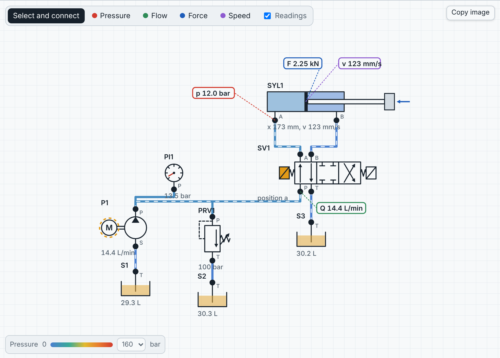
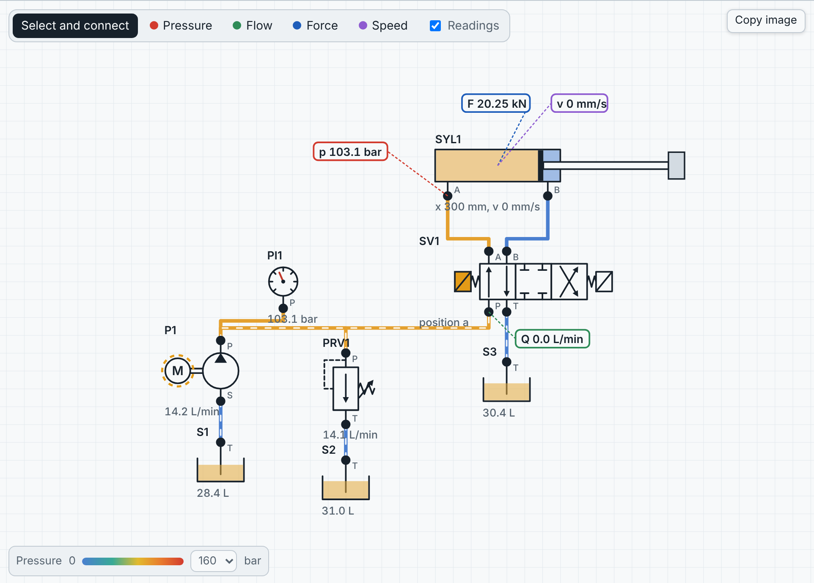
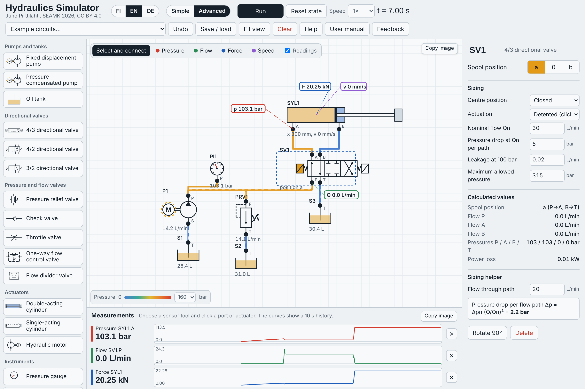

# Hydraulics Simulator – user manual

Juho Pirttilahti, Seinäjoki University of Applied Sciences (SEAMK), 2026 · CC BY 4.0

> This file is the versioned copy of the user manual. When the simulator is changed, update this manual in the same pull request.

## What the simulator is

The Hydraulics Simulator is a browser-based practice environment in which a hydraulic circuit is built from ISO 1219-type graphical symbols and you see immediately how pressure, flow, force and speed behave. No installation is needed, and the circuit is saved automatically in the browser.

Open the simulator at <https://jipirtti.github.io/Hydrauliikkasimulaattori/?lang=en>.

With the simulator you can practise, for example:

- how a pressure relief valve limits the system pressure and where the pump flow goes when the actuator stops
- why a double-acting cylinder retracts faster and with less force than it extends
- how meter-in and meter-out throttling differ, and why meter-out throttling can raise the annulus-side pressure above the system pressure
- how the centre position of a directional valve affects load holding, pump loading and stopping a motor
- sizing components: cylinder bore from force, pump displacement from flow and motor displacement from torque.

The simulator is intended for understanding phenomena. Its results do not replace a system supplier's sizing calculations (see Model limitations).

## Simple and advanced model

The **Simple | Advanced** toggle in the header switches the simulation model in the same way as the language. The switch is made on the fly, the circuit is kept, and the choice is remembered in the browser.

| | Simple | Advanced |
| --- | --- | --- |
| Purpose | Learning the basic equations: the result matches a hand calculation directly | Examining the losses of a real system and their effects |
| Pump | No leakage and no efficiency: Q = Vg·n/1000 | Volumetric and hydromechanical efficiency, leakage increases with pressure |
| Pressure relief valve | Pressure stays at the set value | Pressure rises with the flow (characteristic curve) |
| Directional, check and flow divider valves | Practically no pressure drop and no leakage | Pressure drop Δp = Δpn·(Q/Qn)², leakage |
| Cylinder | No friction: p = F / A | Friction, static friction and viscous damping |
| Hydraulic motor | No leakage and no friction: n = Q / Vg, Δp = 20π·T / Vg | Leakage, efficiency and viscous friction |
| Hoses | No pressure loss; flow velocity and calculated pressure loss are shown for comparison | Pressure loss according to inner diameter and length, hose oil volume included |
| Properties panel | Basic sizing only (e.g. cylinder D, d, stroke, mass, load) | All parameters |

The throttling of the throttle valve and the one-way flow control valve works the same way in both models, because throttling is their purpose. In the simple model the damping of the actuators affects only changes in speed: it damps oscillations, but the pressures and speeds of steady motion match the basic equations. After acceleration the pressure settles in about one second.

Switching the model does not lose values. Loss parameters set in the advanced model (e.g. friction force) are kept and come back into use when you switch back to the advanced model.

The model can be preset in the link: `?mode=simple` or `?mode=advanced` (in Finnish `?malli=yksinkertainen` or `?malli=kehittynyt`), for example https://jipirtti.github.io/Hydrauliikkasimulaattori/?mode=simple. Language and model can be combined: `?lang=en&mode=simple`.

**In assignments**, always state which model the task is to be done with. A good way to proceed is to calculate the phenomenon by hand first, check it with the simple model and then see with the advanced model how much the losses change the result.

## Parts of the view

The view is divided into five areas. On a narrow screen, such as a phone, the areas stack on top of each other and the palette scrolls horizontally.

| Area | Location | What is done there |
| --- | --- | --- |
| Header | Top | Run or pause the simulation, reset the state, choose the speed (1×–0.1×), load an example circuit, undo, save or load, fit the view, clear the canvas, open the help. The simulation time is shown as t = … s. |
| Palette | Left edge | Components by group: pumps and tanks, directional valves, pressure and flow valves, actuators, instruments. |
| Canvas | Centre | The circuit is built and simulated here. In the top left corner is the toolbar (Select and connect, Pressure, Flow, Force, Speed, Readings). At the bottom are the pressure colour scale and warnings. |
| Properties panel | Right edge | Tag, operation, sizing parameters, calculated values and sizing helper of the selected component. When nothing is selected, the panel shows a summary of the circuit and a quick guide. |
| Measurements panel | Bottom centre | The current reading of each sensor and a 10-second curve. A sensor is removed with the ✕ button. |

The canvas is moved by dragging from an empty spot and zoomed with the mouse wheel. Fit view brings the whole circuit onto the screen.

## Building a circuit

A circuit is built in three steps: components onto the canvas, hoses from port to port, sizing values in place.

### Adding and moving a component

1. Drag a component from the palette onto the canvas. Alternatively click it, and it appears in the middle of the view.
2. Move a component by dragging its body. The position snaps to a 10-pixel grid.
3. Rotate the selected component by 90° with the R key or the Rotate 90° button in the properties panel.
4. Delete the selected component with the Delete key or the Delete button. The hoses and sensors attached to it are removed as well.

### Selecting, moving and copying several components

- **Box selection:** hold down the Shift key and drag a box from an empty spot. All components the box touches are selected. Without Shift, dragging moves the view as before.
- **Shift+click** adds a component to the selection or removes it.
- **Ctrl+A** selects all components and **Esc** clears the selection.
- **Moving a group:** drag any selected component, and all selected components move by the same amount. Hoses between the selected components move with their shaped routes. Hoses to components outside the selection stay connected and stretch.
- **Copy and paste:** Ctrl+C copies the selected components, their sizing and the hoses between them. Ctrl+V pastes the copy 40 pixels away with new tags (e.g. SYL2), and the pasted components stay selected so they can be dragged into place at once. Hoses leading outside the selection are not copied.
- **Delete:** Delete removes all selected components.

For a selection of several components, the properties panel shows their tags and the buttons Copy, Paste and Delete selected. Sizing is still edited one component at a time. Box selection and Shift+click need a keyboard, so they do not work on a touch screen.

### Drawing lines

1. Make sure Select and connect is chosen on the toolbar. If a sensor tool is active, a click adds a sensor instead of starting a line. Esc returns to the select tool.
2. Press the mouse button down on the small circle of a port. The cursor changes to a cross. If you press on the body, the component starts to move.
3. Drag onto another port and release. A dashed line shows the attachment point; a distance of about 14 pixels from the port is enough.

The route of the line is drawn automatically at right angles. If lines overlap or the route is otherwise poor, edit it by dragging:

1. Press the mouse button down on the section of the line you want to move. The line is selected and becomes thicker.
2. Drag. A horizontal section moves up or down, a vertical section sideways, and the adjacent sections stretch along. The position snaps to a 10-pixel grid.
3. Release. The ends of the line stay connected to the ports, so the connection and the simulation do not change.

If you drag a section that reaches a port, a new corner is created in the line and the end stays at the port. The edited route is saved with the circuit. When you move a component, the ends of an edited line follow the ports and the route stays rectangular. A double-click on the line or the Automatic route button in the properties panel restores the automatic route, and Undo reverses the drag.

- **Branch (T-junction):** connect a second hose to the same port. A hose cannot be connected to the middle of a line. The hoses of a branch start from the same port; by dragging they can be routed apart.
- **Plug:** an unconnected port is plugged. For example, B of a 4/2 valve can be left unconnected in a single-acting cylinder circuit.
- **Connection state:** a connected port is shown as a filled dot, an unconnected one as an empty circle.
- **Deleting a line:** click the line so that it becomes thicker, and press Delete or Delete connection.
- **Undo:** Ctrl+Z or the Undo button reverses the latest change. 60 steps are kept in memory.

If the ports are hard to hit, zoom in with the mouse wheel.

## Components and sizing

The palette contains 15 components. When a component is selected, its parameters are changed in the Sizing section of the properties panel. The calculated values update during the simulation, and the Sizing helper calculates the required size in reverse.

| Component | Ports | Main sizing parameters | Sizing helper |
| --- | --- | --- | --- |
| Fixed displacement pump | P, S (suction) | Vg (cm³/rev), n (rpm), rated pressure, ηv, ηhm | Vg from the desired flow |
| Pressure-compensated pump | P, S | As above + compensator setting | Vg from the desired flow |
| Oil tank | T | Volume, initial oil volume | – |
| 4/3 directional valve | P, T, A, B | Centre position (closed, tandem, open, float), actuation (detented or spring return), Qn and Δp per path, leakage | Pressure drop at a given flow |
| 4/2 directional valve | P, T, A, B | Actuation, Qn, Δp, leakage. Rest position b: P→B, A→T | Pressure drop at a given flow |
| 3/2 directional valve | P, A, T | Actuation, Qn, Δp, leakage. Position a: P→A, T closed. Rest position b: A→T, P closed | Pressure drop at a given flow |
| Pressure relief valve | P, T | Set pressure, Qn, pressure override at Qn | – |
| Check valve | A → B | Cracking pressure, Qn, Δp at Qn | – |
| Throttle valve | A, B | Opening %, Qn fully open, Δp at Qn | Opening % from the desired flow and pressure difference |
| One-way flow control valve | A, B | Throttling A→B, free flow B→A through the check valve | – |
| Flow divider valve | P (inlet), A, B (outlets) | Split ratio to outlet A (%), Qn, Δp at Qn. Divides the inlet flow to the outlets in a fixed ratio regardless of the load pressures. If one outlet is blocked, the other stops too. In the return direction the valve combines the flows in the same ratio. | – |
| Double-acting cylinder | A (piston side), B (rod side) | D, d, stroke, mass, load and its type, orientation, friction, damping, initial position | D from force and pressure (suggests a standard size D/d), Q from the desired speed |
| Single-acting cylinder | A | D, stroke, mass, load, spring preload and spring rate, orientation | D from force and pressure |
| Hydraulic motor | A, B | Vg, load torque, moment of inertia, friction, ηhm, leakage | Vg from torque and pressure difference, Q from speed |
| Pressure gauge and flow meter | P / A, B | Range | – |

All pressurised components have a Maximum allowed pressure. If the pressure in the circuit exceeds it, a warning appears on the canvas.

**The load type of a cylinder** should be chosen deliberately:

- *Resists motion* acts like friction. It brakes both extension and retraction.
- *Constant force* pushes the rod inwards when F is positive (a negative F pulls outwards). It assists retraction and can cause a running-away load and cavitation.
- *Vertical, extends upwards* adds the weight m·g, which resists extension and lowers the load when the A side is opened to the tank.
- *Vertical, extends downwards* (rod pointing down, hanging load) reverses the direction of gravity: m·g assists extension and resists retraction, so retraction needs a pressure of m·g / (A − a) on the annulus side. Without braking, the load runs away during extension faster than the pump flow and the A side cavitates.

Formulas of the sizing helper:

$$D = \sqrt{\frac{4F}{\pi p}} \qquad V_g = \frac{Q \cdot 1000}{n \cdot \eta_v} \qquad V_g = \frac{20\pi T}{\Delta p \cdot \eta_{hm}}$$

Units: D (m), F (N), p (Pa); Vg (cm³/rev), Q (L/min), n (rpm); T (Nm), Δp (bar).

## Hose sizing

Every hose has an inner diameter and a length. Click a hose and its sizing, calculated values and sizing helper appear in the properties panel.

**Sizing parameters**

| Parameter | Default | Explanation |
| --- | --- | --- |
| Inner diameter di | 12.5 mm | Any value 2–100 mm can be typed into the field. The menu contains the standard hose inner diameters 5, 6.3, 8, 10, 12.5, 16, 19, 25, 31.5, 38 and 51 mm. |
| Length L | 1 m | 0.1–50 m |
| Line type | Automatic | Automatic recognition: a hose to the S port of a pump is a suction line, a hose to a tank or to the T port of a valve a return line, others pressure lines. The type can also be chosen manually; for example, in a regenerative circuit the hose from the T port to the A line is a pressure line. |

**Calculated values**

- Pressure at both ends of the hose and the flow in the hose.
- Flow velocity v = Q / A, where A = π/4·di². The value is shown red if it exceeds the recommendation.
- Recommended velocity according to the line type, flow and pressure (table below).
- Reynolds number Re = v·di / ν and flow regime: laminar (Re ≤ 2300), transitional or turbulent (Re ≥ 4000).
- Friction factor λ: in laminar flow λ = 64 / Re, in turbulent flow from the Blasius formula λ = 0.316 · Re^−0.25.
- Pressure loss Δp = λ · (L / di) · ρ·v² / 2. In laminar flow this equals the Hagen–Poiseuille equation Δp = 128·μ·L·Q / (π·di⁴).
- Oil volume V = π/4·di²·L.

The oil values are those of ISO VG 46 oil at 40 °C: kinematic viscosity ν = 46 mm²/s and density ρ = 870 kg/m³ (dynamic viscosity μ = ρ·ν). In the transitional range (Re 2300–4000) the friction factors are blended smoothly to keep the calculation stable. Local losses of fittings, bends and branches are not calculated.

**Recommended flow velocities**

| Line | Condition | Recommendation |
| --- | --- | --- |
| Suction line | – | 0.5–1.5 m/s |
| Return line | – | 1–3 m/s |
| Pressure line | Q ≤ 10 L/min, p ≤ 160 bar | 1–2 m/s |
| Pressure line | Q ≤ 10 L/min, p > 160 bar | 2–3 m/s |
| Pressure line | Q > 10 L/min, p ≤ 160 bar | 3–5 m/s |
| Pressure line | Q > 10 L/min, p > 160 bar | 5–7 m/s |

Source: SAL Hydro, Technical support – Flow velocity, <https://www.salhydro.fi/en/technical-support/flow-velocity>. Other sources may give slightly different limits. For example, Parker uses 1.2 m/s for suction lines, 3 m/s for return lines and 7.6 m/s for pressure lines.

If the flow velocity exceeds the upper limit of the recommendation, a warning appears on the canvas and names the hose. The lower limit is an economic limit: slower flow means an unnecessarily large and expensive hose, but it does not give a warning.

The **Sizing helper** calculates the smallest inner diameter at a given flow and pressure: di ≥ √(4Q / (π·v_max)), where v_max is the upper limit of the recommendation. The helper suggests the nearest standard size that meets the condition and shows the velocity obtained with it. The Use di = … button applies the size to the hose. The default flow is the current flow in the hose or, if there is no flow, the pump flow.

**Models:** in the advanced model the hose pressure loss and the hose oil volume are included in the calculation. A hose that is too small therefore shows as actuator pressure, a rise in pump pressure and, if necessary, slower motion, and a suction hose that is too small can cause cavitation. In the simple model the hoses have no pressure loss. The flow velocity, Reynolds number and calculated pressure loss are still shown for comparison.

In the example circuits the hoses are sized according to the recommendations. In examples 1–4 (14.5 L/min) the suction line is 19 mm and the other hoses 12.5 mm. In examples 5–7 (43.5 L/min) the suction line is 31.5 mm, the pressure lines 16 mm and the return lines 19 mm. The regenerative lines of example 5 are 25 mm, because their flow is about 140 L/min during rapid traverse. The hose sizing is saved with the circuit and copied with copy and paste.

## Running and controlling the simulation

The simulation starts by itself when the page is opened and runs in real time. First choose the simulation model in the header (Simple or Advanced, see above). The circuit can be edited while the simulation runs: a new connection takes effect immediately.

- **Run / Pause** (or Space) freezes the time. The readings and curves stay visible for examination.
- **Speed** 0.5×, 0.2× or 0.1× slows down fast events, such as the pressure peak when a cylinder hits its end stop.
- **Reset state** sets the pressures to zero, the cylinders to their initial positions and the tanks to their initial filling, and clears the curves. The circuit and sizing are kept.

**Operating a directional valve.** Click the solenoid of the valve, that is, the box with a diagonal line at the end of the symbol. The left solenoid shifts to position a (P→A, B→T), the right one to position b (P→B, A→T). The active solenoid is shown orange, and the squares of the valve slide so that the square in use is aligned with the ports. The position can also be chosen with the buttons a, 0 and b in the properties panel.

- *Detented:* the solenoid stays on until you click it again.
- *Spring return:* the solenoid is on only as long as you hold the mouse button down, and the spring returns the valve to the centre position or, for a 4/2 valve, to rest position b.

**Operating a pump.** Click the electric motor M of the pump or the button in the panel. An orange dashed line rotates around a running motor. The pump speed rises in about 0.1 seconds at start-up.

**The throttle opening** is adjusted with the slider in the properties panel, and the change shows in the speed immediately.

## Measurements and sensors

Measurement information is available in four ways: sensors, instrument components, hose colours and the quick reading under the mouse.

### Sensors (probe tools)

Choose a sensor on the toolbar and click the target. The label of the sensor appears on the drawing and its curve in the measurements panel. The label can be moved by dragging.

| Sensor | Attached to | Shows | Unit |
| --- | --- | --- | --- |
| Pressure (p) | A port (also at the end of a hose or the nearest port of a component) | Pressure at the port | bar |
| Flow (Q) | A port | Flow through the port. Positive = flows into the component. | L/min |
| Force (F) | A cylinder | Hydraulic force pA·A − pB·(A − a). Positive pushes outwards. | kN |
| Force (T) | A motor | Torque | Nm |
| Speed (v) | A cylinder | Piston speed. Positive = extension. | mm/s |
| Speed (n) | A motor | Rotational speed | rpm |

The curve shows a 10-second history and scales automatically. The upper and lower limits of the scale are shown at the left edge of the curve. A sensor is removed with the ✕ button in the measurements panel.

### Other readings

- **The colour of a hose** shows the pressure: blue is low, green and yellow medium, red close to the maximum of the scale. The maximum (100, 160, 250 or 400 bar) can be changed with the selector in the bottom corner. Violet means vacuum.
- **A moving dashed line** in a hose shows the direction of flow, and its speed increases with the flow. A stationary solid line = no flow.
- The **Readings** option shows a short reading below each component, such as the position and speed of a cylinder, the flow of a pump or the position of a valve.
- **Hovering** over a port or hose shows the instantaneous pressure and flow.
- The **pressure gauge** and **flow meter** are circuit components. They are suitable when the measurement is to be shown on the drawing as on a real machine.
- **The cylinder chambers** are coloured according to pressure, so the pressure difference between the A and B sides is seen directly from the symbol.

## Example circuit: double-acting cylinder and 4/3 valve

The values in this section have been calculated with the advanced model, which also includes the hose pressure losses. With the simple model the A-side pressure during extension is 10.2 bar (= 2 kN / 19.6 cm², no friction) and about 100 bar at the end stop.

Example circuit 1 is the basic hydraulic circuit: the pump delivers 14.5 L/min, the pressure relief valve limits the pressure to 100 bar, and a 4/3 valve controls a Ø50/28 cylinder with a load of 2 kN. Load it from the header menu Example circuits → 1.

### Parts of the circuit

| Tag | Component | Function in the circuit |
| --- | --- | --- |
| P1 | Fixed displacement pump 10 cm³/rev, 1450 rpm | Delivers about 14.5 L/min. Draws from tank S1. |
| PRV1 | Pressure relief valve, set to 100 bar | Opens when the pump flow has no other route and returns the oil to tank S2. |
| PI1 | Pressure gauge | Shows the pressure in the pressure line. |
| SV1 | 4/3 directional valve, closed centre | Directs the oil to the A or B side of the cylinder. Return to tank S3. |
| SYL1 | Double-acting cylinder Ø50/28, stroke 300 mm | Actuator. A load of 2000 N resists the motion. |

The circuit has four sensors ready: pressure at the A port of SYL1, flow at the P port of SV1, and force and speed of SYL1.

### Step 1: idle

When SV1 is in the centre position, the P port is closed, so the whole pump flow goes through PRV1 to the tank. PI1 shows about 103 bar, and the reading of PRV1 is about 14 L/min. The pressure line is orange and the return line of PRV1 blue, with the dashed line moving towards the tank. This is the idle power loss: about 2.4 kW turns into heat, which you can see by selecting PRV1.

### Step 2: extension (solenoid a)

Click the left solenoid of SV1. The solenoid turns orange and the left square, with arrows straight up and down, slides into line with the ports: P→A and B→T.

The figure shows:

1. **The pressure falls to match the load.** The A side has 12.0 bar, because the pressure is determined by the load and not by the pump: the 2 kN load and friction divided by the piston area of 19.6 cm² correspond to about 11–12 bar. All hoses are blue, that is, at low pressure.
2. **The whole flow goes to the cylinder.** The flow at the P port of SV1 is 14.5 L/min, and PRV1 is closed (its reading returns to the set value of 100 bar).
3. **The speed comes from the flow and the area.** v = Q / A = 14.5 L/min / 19.6 cm² ≈ 123 mm/s, the same as on the speed sensor.
4. **The force sensor** shows 2.25 kN, the sum of the load and the friction.
5. **The direction of flow** is seen from the dashed lines: in the pressure line from the pump to the valve and to the A side of the cylinder, from the B side through the valve to tank S3.
6. **The cylinder chambers** are almost the same colour, because the pressure difference is small.

### Step 3: cylinder at the end stop

When the piston reaches the end of the 300 mm stroke, the oil has nowhere to go, so the pressure rises to the opening pressure of PRV1.

1. **The pressure rises to the system pressure.** The A-side pressure is 103.1 bar and the hoses are orange. On top of the 100 bar setting come 2.8 bar, because PRV1 needs a pressure rise to pass 14 L/min, and 0.3 bar from the hose between the pump and PRV1, through which the whole flow now passes.
2. **The force is the maximum possible.** 103.1 bar × 19.6 cm² = 20.2 kN, the same as on the force sensor. This is the thrust of the cylinder at this pressure level.
3. **The speed is zero and the P flow is 0 L/min.** The whole flow circulates through PRV1 to tank S2, which is seen from the reading of PRV1 (14.1 L/min).
4. **The curves** in the measurements panel show the step: the pressure stays low during the motion and jumps up at the stop, while the speed drops to zero.

### Step 4: retraction (solenoid b)

Click the right solenoid. The crossed arrows come into line with the ports: P→B and A→T. The cylinder retracts at about 178 mm/s, that is, faster than it extends, because the annulus area (13.5 cm²) is smaller than the piston area. For the same reason the maximum pulling force remains at about 14 kN.

### The whole view

In the properties panel on the right, SV1 is selected: solenoid position a, sizing values and calculated values. At the bottom the measurements panel draws the curve of each sensor.

## Other example circuits and exercises

The example circuits are loaded from the header menu. Loading replaces the current circuit, but Undo restores it. The values in the table below are from the advanced model; the values of the simple model follow the table.

| Example | What to do | What you should see |
| --- | --- | --- |
| 2. Meter-out speed control | Click the left solenoid of SV1. | The cylinder extends at about 65 mm/s, although the free speed would be 123 mm/s. The excess pump flow goes through the pressure relief valve to the tank, so the A side has about 101 bar. On the B side the pressure rises to about 123 bar, that is, above the system pressure, because the annulus area is smaller than the piston area. Retraction goes through the check valve at full speed. |
| 3. Hydraulic motor and flow meter | Click solenoid a or b of SV1. | The motor turns at about 700 rpm in both directions, and the A-side pressure is about 67–76 bar (20 Nm load). In the tandem centre position the motor stops and the pump circulates the oil to the tank at almost no pressure. |
| 4. Single-acting vertical cylinder, controlled lowering | Switch the solenoid of the 4/2 valve on and off again. | Lifting at about 190 mm/s with a pressure of about 15 bar (150 kg load). When lowering, the A side opens to the tank and the throttle limits the lowering speed to about 120 mm/s. Without the throttle the load would fall almost freely. |
| 5. Regenerative circuit with a 3/2 valve | Pump 43.5 L/min, pressure relief 50 bar, cylinder Ø60/30, 1000 kg horizontal. SV2 is in its rest position (rapid traverse): click solenoid a of SV1. Then switch SV2 to position a (normal) and run again. | In rapid traverse the oil from the annulus side circulates to the A side, and the speed is v = Q / a ≈ 1.0 m/s. Normally extension is 256 mm/s and retraction 341 mm/s. Retraction is possible only in position a of SV2, because in the rest position the B line of the main valve is closed. Mount the cylinder vertically (Orientation: Vertical, extends upwards): rapid traverse does not lift the 1000 kg load, because the force is only p·a = 50 bar · 707 mm² ≈ 3.9 kN. The rapid traverse speed falls short of theory if SV2 is undersized (try Qn 30 L/min). |
| 6. Motor in parallel with a cylinder | The same pump and the cylinder vertical; a motor Vg 20 cm³/rev is connected between the A and B lines. Click solenoid a of SV1 and try motor load torques of 0, 5 and 40 Nm. | Flow takes the path of least pressure. 0 Nm: the motor takes the whole flow (about 2160 rpm) and the load does not rise. 5 Nm: the cylinder starts to rise but slows down as the motor accelerates. 40 Nm: the motor would need about 140 bar, so it does not turn and the cylinder gets the whole flow (253 mm/s). |
| 7. Flow divider valves and check valves | As example 6, but with flow divider valves (50/50) in the A and B lines and return-flow check valves in parallel with them. Click solenoid a of SV1 and keep it on until the cylinder is at its end stop. | The cylinder (127 mm/s) and the motor (about 1060 rpm) move at the same time, because each gets half of the flow regardless of the load pressures. When the cylinder is at its end stop, the cylinder outlet of the flow divider is blocked and the motor stops too; the pressure rises to the opening pressure of the pressure relief valve. The check valves let the returning oil bypass the flow divider, so the return flow does not pass through the divider. |

Values of the simple model in the same examples (matching the hand calculation):

| Example | Simple model | Hand calculation |
| --- | --- | --- |
| 1 | Out 123 mm/s and 10.2 bar, in 179 mm/s, at end stop 100 bar | v = Q/A, p = F/A, v = Q/(A − a) |
| 3 | 725 rpm, pressure difference 62.8 bar | n = Q/Vg, Δp = 20π·T/Vg |
| 5 | Rapid traverse 1.02 m/s | v = Q/a |
| 6 (motor 40 Nm) | Cylinder 256 mm/s, lifting pressure 34.7 bar | v = Q/A, p = m·g/A |
| 7 | Cylinder 128 mm/s, motor 1090 rpm | v = (Q/2)/A, n = (Q/2)/Vg |

### Exercises

The model intended for the exercise is given in brackets.

1. (Simple) In example 1, calculate the extension and retraction speeds of the cylinder by hand from the pump flow. Check the result with the speed sensor.
2. (Advanced) Change the centre position of the valve in example 1 to tandem. What happens to the flow through the pressure relief valve and to the pump power demand in the centre position?
3. (Simple) Increase the load of the cylinder in example 1 to 25 kN. Why does the cylinder not extend? Size a new cylinder with the Sizing helper and try it.
4. (Advanced) Move the throttling of example 2 to the inlet side (A line) and compare the B-side pressure with meter-out throttling.
5. (Advanced) Remove the throttle from example 4 and connect the valve directly to the cylinder. Follow the lowering speed and the A-side pressure during lowering.
6. (Advanced) Change the pump of example 1 to pressure-compensated (compensator setting 90 bar). What happens to the flow through the pressure relief valve when the cylinder is at its end stop?
7. (Simple, then advanced) Set the orientation of the cylinder in example 1 to Vertical, extends downwards and the mass to 1000 kg. Run the cylinder in both directions. Why is extension faster than the pump flow, and at which pressure relief setting does the cylinder rise back? Compare with the hand calculation m·g / (A − a).
8. (Simple) Remove the flow divider valves and check valves of example 7 and replace them with direct hoses. What happens to the motor and the cylinder now, and why does the result differ from the one with the flow divider?
9. (Both) Run example 1 out first with the simple and then with the advanced model. Record for both the A-side pressure during the motion, the speed and the pressure at the end stop. Which losses cause the differences? Calculate the hydraulic efficiency of the advanced model during the motion (useful power F·v divided by the pump power p·Q).
10. (Both) Run example 5 in rapid traverse with both models. Why does the speed fall short of the theoretical value in the advanced model, and what happens when the rated flow of SV2 is reduced to 30 L/min?
11. (Advanced) In example 1, change the inner diameter of the hose SV1.A–SYL1.A to 6.3 mm and its length to 10 m. During extension, calculate by hand the flow velocity, Reynolds number and pressure loss in the hose and compare with the readings. How does the change show in the pump pressure and the A-side pressure of the cylinder? Then size the hose with the sizing helper.
12. (Advanced) In example 5, change the inner diameter of the regenerative lines (SV1.A–SYL1.A, SV2.A–SYL1.B and SV2.T–SYL1.A) to 12.5 mm. What happens to the rapid traverse speed and to the pressures, and in which hose is the flow turbulent?

When writing your own assignments for the simulator, give the pump flow, the pressure relief setting, the cylinder dimensions and stroke, the rated flow of the valves and the motor load torque. The rapid traverse speed and the behaviour of parallel actuators in particular depend on these values.

## Copying a chart as an image

Every chart has a **Copy image** button in its corner. It copies the chart to the clipboard as a PNG image that can be pasted directly into a report, a slide or a message (Ctrl+V).

- The image is always drawn on a light background, even when the simulator is in a dark theme, and at double resolution.
- The image contains the chart title, the chart, the legend and a source note (simulator name, Juho Pirttilahti, SEAMK, CC BY 4.0, web address and date).
- The buttons are in the top right corner of the canvas (hydraulic diagram and pressure colour scale) and on the Measurements title row (all sensor curves with their readings as one image).
- The whole hydraulic diagram is copied regardless of the zoom and the visible area. Selection frames and the background grid are left out.
- If the browser does not allow copying to the clipboard, the image opens in a window. From there it can be copied with the right mouse button (on a phone with a long press) or saved as a PNG file.

## Warnings, saving and limitations

### Warnings and troubleshooting

Warnings are shown at the bottom of the canvas as boxes with a red border.

| Warning | Cause | Remedy |
| --- | --- | --- |
| Pressure exceeds the rated value | The pressure at a port is above the component's Maximum allowed pressure. | Lower the setting of the pressure relief valve or choose a more robust component. |
| The pump is starved of oil | The suction port S of the pump is unconnected or blocked. | Connect S to the T port of a tank. |
| Vacuum (cavitation) | The pressure of some node has dropped below −0.95 bar, for example due to a running-away load or a braking motor. | Add back pressure, meter-out throttling or a make-up line. |
| Pressure runaway | The flow of a fixed displacement pump has no route, and the circuit has no pressure relief valve. | Add a pressure relief valve to the pump pressure line. |
| Numerical error | The calculation did not converge; the pressures were reset. | Check the connections and extreme parameters, press Reset state. |

If the cylinder does not move, first check that the valve solenoid is on and the pump is running. Then see whether the force is sufficient: the hydraulic force is less than the sum of the load, friction and static friction (1.25 × friction force).

### Saving and sharing

The circuit, sizing and sensors are saved automatically in the browser's storage and are restored when the page is opened in the same browser. Save / load opens the circuit in text form (JSON). Copy the text for safekeeping, and you can share it, for example, with students as an assignment template. Loading is done by pasting the text into the field and choosing Load.

### Model limitations

The pressures are solved implicitly with a 1 ms time step from the compressibility of the oil (effective bulk modulus 1.2 GPa) and the orifice equation Q = Cd·A·√(2Δp/ρ). A cylinder has mass, friction, static friction and end stops; a motor has a moment of inertia and a load torque. In the advanced model the hose pressure loss is calculated from the inner diameter and length (see Hose sizing). The model does not include local losses of fittings, bends and branches, hose compliance, heating, change of viscosity with temperature or the control dynamics of valves. In the simple model the flow of individual hoses cannot be determined in loops formed by parallel hoses.

### Keyboard shortcuts

| Key | Function |
| --- | --- |
| Space | Run or pause |
| Delete / Backspace | Delete the selected components or hose |
| R | Rotate selected by 90° |
| Ctrl+Z | Undo |
| Ctrl+C / Ctrl+V | Copy and paste the selected components with their hoses |
| Ctrl+A | Select all components |
| Shift+drag from an empty spot | Box selection |
| Shift+click | Add a component to or remove it from the selection |
| V or Esc | Select and connect tool (Esc also clears the selection) |
| Mouse wheel | Zoom |

## Author and licence

Author: Juho Pirttilahti, Seinäjoki University of Applied Sciences (SEAMK), 2026. Design, content and validation: Juho Pirttilahti. Code implemented with AI assistance (Claude, Anthropic).

This user manual and the Hydraulics Simulator software are licensed under the [Creative Commons Attribution 4.0 International licence (CC BY 4.0)](https://creativecommons.org/licenses/by/4.0/). You may copy, share and adapt the material for any purpose, provided you credit the author and the institution, indicate the licence and state if you have changed the material.

Recommended citation: Pirttilahti, J. (2026). *Hydraulics Simulator and user manual.* Seinäjoki University of Applied Sciences. CC BY 4.0.
